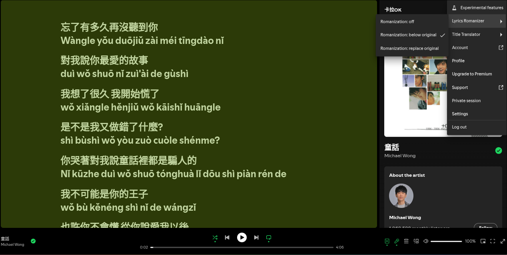

# Translatify
Language support for Spotify(spicetify) via Google Translate

## features / showcase
1. Title translation 


---
2. Lyric romanization


## installation
1. download the .js file
```bash
git clone https://github.com/penguinerd/translatify.git
```

2. move the file into your spicetify extensions folder
    - **Windows:** `%appdata%\spicetify\`
    - **Linux/macOS:** `~/.config/spicetify/`

3. enable, apply config
```bash
spicetify config extensions titleTranslatify.js
spicetify config extensions lyricsRomanify.js
spicetify apply
```

## usage:

### title translation
1. navigate to upper right (where your profile picture is)
    this is the same place where you find settings, account, profile, logout, etc
2. locate "Title Translator"
3. set to auto translate or keep it manual
4. choose display setting
5. select target language
6. play a song and hit `Translate current title` if on manual

### lyric romanization
1. locate "Lyrics Romanizer"
2. turn on romanization
3. choose display setting
4. open lyrics tab in spotify

## uninstall:
1. remove the extension
```bash
spicetify config extensions titleTranslatify.js-
spicetify config extensions lyricsRomanify.js-
spicetify apply
```
2. delete the file from the folder

## notes:
1. relies on google's free translate api
2. will not work once you hit the cap
